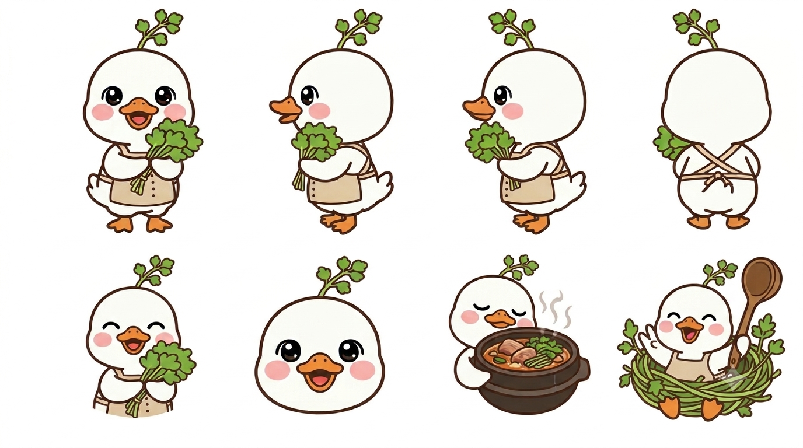

# 오미 캐릭터 시트 — 이미지 요청문

- 쓰는 곳: 챗지피티(이미지 만들기)에 아래 요청문을 붙여 넣는다
- 기준 그림: 팀 `brand/character-sheet.png` — 이 그림이 다시 나오도록 그림 속 생김새를 그대로 옮겨 적었다
- 캐릭터: 팀 `brand/world-bible.md`의 주인공 오미
- 작성: 박준영 (2026-11-19, `brand/character-sheet.png`를 보고 다시 씀)



## 1. 그림에서 읽은 특징

| 항목 | 그림 속 모습 |
|---|---|
| 배치 | 2줄 × 4개, 순백 배경, 글자 없음 |
| 윗줄 | 정면 / 왼쪽을 보며 걷는 옆모습 / 왼쪽을 보는 3/4 옆모습 / 뒷모습 (옆모습 2개가 **같은 방향**) |
| 아랫줄 | 눈 감고 웃는 상반신 / 얼굴 클로즈업 / 김 나는 뚝배기를 안은 모습 / 미나리 둥지에서 국자를 든 모습 |
| 몸 | 큰 동그란 머리, 약 2등신, 흰 몸, 짧은 꼬리깃이 위로 살짝 |
| 선 · 색 | 굵은 짙은 갈색 외곽선, 평면 채색, 분홍 동그란 볼 |
| 눈 | **반짝이가 있는 큰 까만 눈**(점눈 아님). 웃을 때는 ^ ^ 감은 눈 |
| 부리 · 발 | 주황 부리(웃으면 분홍 혀), 주황 세 갈래 물갈퀴 발 |
| 머리 | 가는 미나리 줄기 1개, 작은 잎 여러 장 |
| 앞치마 | 베이지, 가운데 작은 갈색 단추 두 줄, 등에서 끈이 X자로 교차하고 허리에 매듭 |
| 소품 | 미나리 다발(양 날개로 안음), 뚝배기(붉은 국물 + 오리고기 + 미나리), 미나리 둥지, 큰 나무 국자 |

## 2. 이미지 요청문

```
캐릭터 시트 한 장을 그려 줘. 순백 배경에 그림 8개를 2줄 × 4개로 깔끔하게 나란히 놓아 줘. 글자, 숫자, 이름표는 넣지 마.

[캐릭터]
- 새로 만든 귀여운 흰 오리 캐릭터 '오미'. 약 2등신, 크고 동그란 머리에 작고 통통한 몸.
- 몸은 따뜻한 흰색. 엉덩이 쪽에 짧은 꼬리깃이 위로 살짝 올라가 있다.
- 부리와 발은 주황색. 발은 세 갈래 물갈퀴 발.
- 눈은 크고 까만 동그란 눈에 흰 반짝이 점이 하나씩 있다. 볼에 분홍색 동그란 볼터치.
- 웃을 때는 부리를 벌려 분홍 혀가 살짝 보인다.
- 머리 꼭대기에 가는 미나리 줄기 하나가 쏙 나 있고, 작은 초록 잎이 여러 장 달려 있다.
- 베이지색 앞치마를 둘렀다. 앞치마 가운데에 작은 갈색 단추가 세로 두 줄로 있다. 등 뒤에서는 앞치마 끈이 X자로 교차하고 허리에서 매듭으로 묶여 있다.

[그림체]
- 한국 귀여운 스티커 캐릭터 그림체.
- 굵고 둥근 짙은 갈색 외곽선, 평면 채색, 그림자는 거의 없게.

[윗줄 — 전신 4개, 같은 크기]
1. 정면: 양 날개로 초록 미나리 다발을 가슴에 안고 활짝 웃는다.
2. 왼쪽을 보는 옆모습: 미나리 다발을 안고 한 발을 들어 걷는다.
3. 왼쪽을 보는 3/4 옆모습: 미나리 다발을 안고 서 있다.
4. 뒷모습: 얼굴은 보이지 않는다. 머리 위 미나리, 등의 X자 앞치마 끈과 매듭, 옆으로 삐져나온 미나리 다발 끝이 보인다.

[아랫줄]
5. 상반신: 눈을 ^ ^ 모양으로 감고 웃으며 미나리 다발을 안고 있다.
6. 얼굴 클로즈업: 큰 반짝이는 눈, 벌린 부리, 분홍 볼, 머리 위 미나리.
7. 뚝배기: 김이 모락모락 나는 짙은 갈색 뚝배기를 양 날개로 안고, 눈을 감고 행복하게 냄새를 맡는다. 뚝배기 안에는 주황빛 국물, 오리고기 몇 점, 초록 미나리가 있다.
8. 미나리 둥지: 미나리 줄기로 엮은 둥근 둥지에 앉아, 한쪽 날개로 손을 흔들고 다른 날개로 큰 나무 국자를 들고 웃는다.

[지킬 것]
- 여덟 그림 모두 같은 캐릭터다. 머리 미나리, 앞치마와 단추, 몸 색, 부리와 발 색이 모두 똑같아야 한다.
- 실제 사람이나 이미 있는 캐릭터·마스코트를 닮지 않게 새로 그린다.
- 글자, 로고, 워터마크는 넣지 않는다.
```

## 3. 비슷하게 뽑는 요령

- **가장 확실한 방법:** `brand/character-sheet.png`를 챗지피티에 함께 올리고, 요청문 맨 앞에 "첨부한 그림과 같은 캐릭터, 같은 그림체로"를 붙인다. 글로만 쓰면 매번 조금씩 다르게 나온다.
- **옆모습:** 기준 그림은 2번과 3번이 둘 다 왼쪽을 본다. 서로 반대 방향으로 뽑으려면 3번을 "오른쪽을 보는 옆모습"으로 바꾼다.

## 4. 팀 규칙과 다른 점

이 요청문은 기준 그림을 그대로 따라 썼기 때문에, 팀 파일과 다른 곳이 있다. 공개용으로 쓰기 전에 팀에서 정한다.

| 그림 속 모습 | 팀 파일 기준 | 근거 파일 |
|---|---|---|
| 붉은빛 국물 | 빨강은 크게 쓰지 않는다 (구단 색처럼 보일 수 있음) | `brand/world-bible.md` 5번 |
| 단추 있는 앞치마 | 앞치마에 "점 다섯 개" | `brand/world-bible.md` 2번 |
| 미나리 다발 · 둥지 | 미나리를 꽂은 흰 오리 (다발 · 둥지는 상상) | `brand/world-bible.md` 2번 |

## 5. 고친 기록

| 날짜 | 바꾼 것 |
|---|---|
| 2026-11-19 | 요청문 A(머리 미나리 1줄기) · B(없음) 처음 올림 |
| 2026-11-19 | 팀원이 '가늘고 날씬한 부분'에서 목을 뺌 |
| 2026-11-19 | `brand/character-sheet.png`를 기준으로 요청문을 하나로 다시 씀 (A · B 대신) |
